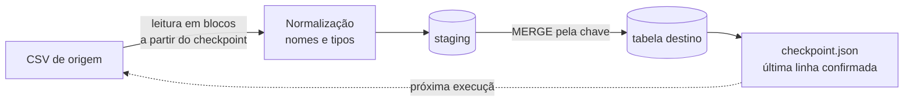

# 🗄️ ETL incremental em Python: CSV → staging → MERGE

Carga incremental e idempotente de arquivos grandes em banco relacional, com leitura em blocos, tabela de staging, `MERGE` e checkpoint.

> ⚠️ **Dados fictícios.** O CSV de agenda de instrutores é gerado por script. A arquitetura é a que uso em repositórios de dados institucionais em SQL Server.

## 🎯 Problema de negócio

Um sistema operacional exporta diariamente um CSV que só cresce. Carregá-lo inteiro a cada execução é lento, estoura a memória e, se algo falhar no meio, deixa o banco em estado incerto. O objetivo é carregar **apenas o que é novo**, poder **reexecutar sem duplicar** e **retomar do ponto em que parou**.

## 🏗️ Arquitetura



| Decisão | Motivo |
|---|---|
| Leitura em blocos (`chunksize`) | Memória constante, independentemente do tamanho do arquivo |
| Um bloco = uma transação | Falha no meio não deixa carga pela metade |
| Staging + `MERGE` | Reprocessar um bloco atualiza em vez de duplicar |
| Checkpoint gravado só após o commit | A retomada nunca pula dados |
| Conversão para tipos nativos do Python | Drivers ODBC rejeitam tipos do numpy/pandas |
| Credenciais em variável de ambiente | Nenhum segredo no código ou no repositório |

## ▶️ Como executar

```bash
pip install -r requirements.txt

# 1. gerar dados fictícios (722 mil linhas)
python scripts/gerar_dados_ficticios.py dados/agenda.csv --linhas 722000

# 2. carga inicial (usa SQLite local por padrão)
python src/etl_incremental.py dados/agenda.csv

# 3. simular a chegada de dados novos e rodar de novo
python scripts/gerar_dados_ficticios.py dados/agenda.csv --linhas 3000 --anexar --semente 7
python src/etl_incremental.py dados/agenda.csv
```

Para apontar para SQL Server, copie `.env.example` para `.env` e preencha `ETL_DB_URL`.

## 📊 Resultado da demonstração

| Execução | Linhas lidas | Carregadas | Rejeitadas (sem chave) | Tempo |
|---|---:|---:|---:|---:|
| Carga inicial | 722.000 | 719.841 | 2.159 | ~10 s |
| Incremental (+3.000 linhas) | 3.000 | 2.993 | 7 | < 1 s |
| Reexecução sem dados novos | 0 | 0 | 0 | < 1 s |

Medido em SQLite local, com blocos de 50 mil linhas. Linhas com data inválida são carregadas com a data nula; linhas sem chave são rejeitadas e contadas.

## ✅ Testes

```bash
pytest -q
```

Os testes cobrem carga inicial, reexecução, carga incremental, reprocessamento do zero (idempotência), detecção de separador e a geração da instrução `MERGE` do SQL Server.

## ⚠️ Limites conhecidos

- O checkpoint por número de linha pressupõe um arquivo **somente de inclusão** (append-only). Para capturar alterações em linhas antigas, apague o checkpoint e reprocesse: o `MERGE` atualiza os registros sem duplicar.
- A demonstração e os testes rodam em SQLite. O caminho do SQL Server usa a mesma lógica com a instrução `MERGE` e precisa do driver ODBC instalado.

## 🛠️ Tecnologias

Python · pandas · SQLAlchemy · SQL Server (`MERGE`) · SQLite · pytest

## 👤 Autor

**Newton Giovanni** · Economista e Analista de Dados Estratégicos · [LinkedIn](https://www.linkedin.com/in/newton-giovanni/)
